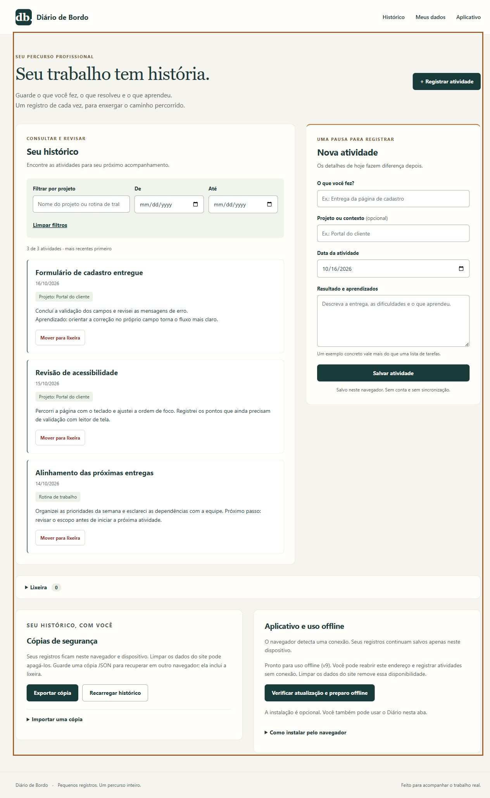

# Diário de Bordo

Histórico pessoal de atividades, entregas e aprendizados para profissionais que
atuam em diferentes projetos. Resolve a dificuldade de recuperar exemplos concretos
do trabalho ao preparar acompanhamentos e revisões semanais.



Refatoração desta versão concluída. As validações externas ainda pendentes estão registradas na [revisão de entrega](docs/REVISAO-FINAL.md).

## Funcionamento

- Registre título, projeto opcional, data, resultado e aprendizados.
- Consulte por projeto e período, da atividade mais recente para a mais antiga.
  A busca ignora acentos e maiúsculas; as datas dos limites são incluídas.
- Mova atividades para a lixeira e restaure quando necessário, sem expiração automática.
- Exporte uma cópia JSON com a lixeira. Importe após conferir a prévia e confirmar.
  Repetições idênticas são ignoradas; IDs iguais com conteúdo diferente bloqueiam
  a importação inteira, sem sobrescrever registros.
- Após o preparo inicial, reabra o endereço e registre atividades sem conexão.

Os registros ficam no `localStorage` deste navegador. Não há conta, servidor de dados
ou sincronização. Limpar os dados do site pode apagar histórico e disponibilidade
offline. Instalar a PWA não cria backup: guarde cópias exportadas.

## Execução local

Requer Node.js 22 ou superior. Na pasta do projeto:

```sh
npm start
```

Abra http://127.0.0.1:4174. Não é necessário instalar pacotes. Use sempre o mesmo
endereço e porta para acessar o mesmo armazenamento. O servidor incluído é apenas
para desenvolvimento; abrir `index.html` diretamente não é suportado.

```sh
npm test
```

Existe uma [cópia com dados fictícios](docs/exemplo-importacao.json) para experimentar
importação. Ela não é carregada automaticamente. Prefira um perfil separado para demonstrações.

## Tecnologias e versões verificadas

| Tecnologia | Uso / versão |
| --- | --- |
| HTML e CSS | Estrutura semântica, Grid, Flexbox e media queries |
| JavaScript | Módulos nativos, sem framework ou biblioteca externa |
| Node.js | 24.14.0 verificado; requisito declarado: 22 ou superior |
| node:test e node:assert/strict | Testes nativos do Node.js |
| Manifesto e Service Worker | Instalação opcional e offline; cache atual v11 |
| Aplicação | 0.1.0 no package.json, refatoração concluída |

A verificação visual usou o navegador integrado do Codex. Não foi identificada uma
versão independente desse navegador; os resultados não comprovam compatibilidade universal.

## Organização e decisões técnicas

- `script.js`: formulário, histórico, filtros e confirmação da importação.
- `armazenamento.js`: validação, leitura, gravação, exportação e preparação da importação.
- `consulta.js`: seleção e ordenação sem alterar a lista armazenada.
- `pwa.js`: instalação e comunicação sobre preparo offline e atualizações.
- `service-worker.js`: cache dos arquivos, separado por escopo e versão.
- `servidor.js`: servidor local com módulos nativos do Node.js.
- `tests/`: casos de sucesso e falha, com armazenamento e interface simulados.

Funções diretas e nomes descritivos evitam camadas desnecessárias. Comentários no
JavaScript explicam as proteções importantes. Uma gravação só aparece como concluída
após o armazenamento confirmar sucesso; falhas preservam o formulário.

Um histórico ilegível bloqueia novas gravações e pode ser exportado no formato bruto
para recuperação. Nunca é substituído silenciosamente por uma lista vazia. Essa
recuperação pode exigir correção manual do arquivo.

A importação aceita até 2 MB e valida todos os registros antes da confirmação. Se o
histórico mudar depois da prévia, uma nova conferência é exigida. A chave e os IDs
numéricos antigos são preservados; novos registros usam UUID.

Alterações detectadas entre abas bloqueiam uma gravação desatualizada. Como o
localStorage não oferece transações atômicas, gravações exatamente simultâneas
permanecem uma limitação. Este é um diário pessoal, não um sistema colaborativo.

## Instalação, offline e publicação

A seção **Aplicativo e uso offline** informa o preparo e orienta a instalação.
O primeiro acesso exige conexão. O cache guarda arquivos da aplicação; os registros
ficam separados, no armazenamento local.

Uma atualização aguarda o encerramento de todas as abas e janelas da versão anterior.
Salve o preenchimento antes de fechar e reabrir. Não há ativação forçada nem recarga
automática durante o preenchimento.

Em produção, publique os arquivos estáticos em HTTPS. Ao alterar arquivos da aplicação,
incremente a versão do cache e publique o conjunto completo. Consulte o
[guia da PWA](docs/PWA.md) para procedimento, matriz testada e limitações.

## Verificação e dificuldades

**48 testes automatizados passaram**, cobrindo dados inválidos, compatibilidade,
falha de gravação, conflito entre abas, lixeira, PWA, filtros e importação. Os testes
simulados complementam a verificação no navegador; não a substituem.

No navegador foram conferidos importação com prévia, consulta combinada, restauração
com foco, persistência após recarga e reabertura com filtros após desligar o servidor.
O layout foi conferido em larguras de 320, 390, 844 e 1280 pixels.
Veja [os resultados da etapa 3](docs/ETAPA-3.md).

As principais dificuldades foram evitar perda silenciosa de registros, atualizar o
cache sem interromper o preenchimento e importar sem duplicar ou sobrescrever atividades.
Validação antes de gravar, atualização adiada e prévia de importação tratam esses problemas.
O histórico recebeu prioridade visual para facilitar a revisão do trabalho.

Faltam instalação e uso em dispositivos reais, modo avião, atualização em HTTPS,
leitor de tela e auditoria completa de acessibilidade. Não há alegação de conformidade
ou compatibilidade universal. A explicação didática está no [guia do código](docs/GUIA-DO-CODIGO.md). As pendências estão no [plano completo](PLANO.md).

## Experiência em tela pequena


As imagens usam dados fictícios. O histórico vem antes do formulário na leitura;
o atalho **Registrar atividade** leva diretamente ao campo de título.

As [referências de código e um exemplo de teste](docs/REFERENCIAS-DE-CODIGO.md)
registram a revisão de legibilidade feita durante o desenvolvimento.

## Revisão e guia de estudo

Consulte a [revisão de entrega](docs/REVISAO-FINAL.md) para correções, contraste medido e verificações pendentes. O [guia detalhado do código](docs/GUIA-DO-CODIGO.md) explica armazenamento, expressões regulares, importação, PWA e testes. As imagens acima registram a etapa 3; a revisão inclui a correção posterior dos filtros em telas estreitas.


