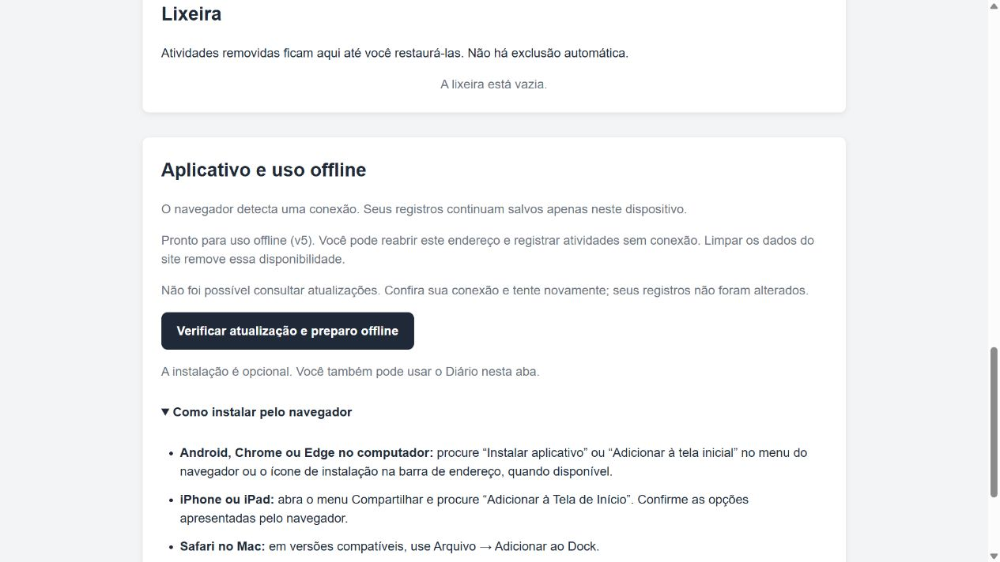

# PWA: funcionamento, publicação e verificação

## O que o usuário encontra

A seção **Aplicativo e uso offline** informa se o navegador detecta conexão e se
os arquivos da aplicação estão disponíveis no cache. São verificações diferentes:
uma conexão detectada não garante acesso ao servidor.

O primeiro acesso precisa de conexão. Aguarde **Pronto para uso offline** antes
de depender do aplicativo sem rede. Depois disso, é possível reabrir a página
inicial, registrar atividades, consultar o histórico e usar a lixeira sem servidor.
O cache não é backup: os registros ficam separadamente no `localStorage`.

O botão de instalação aparece apenas quando o navegador fornece um convite válido.
Depois de recusado ou utilizado, o convite é descartado. Aceitação do convite e
confirmação de instalação são estados distintos. As instruções alternativas ficam
disponíveis mesmo em navegadores que não fornecem esse evento.

## Atualização sem interrupção

1. O navegador encontra um `service-worker.js` alterado.
2. A nova versão baixa todos os arquivos essenciais em seu próprio cache.
3. Se algum download falhar, a instalação não termina; a versão anterior permanece.
4. Com as abas antigas abertas, a atualização fica em espera. A interface avisa para
   salvar a atividade, fechar todas as abas/janelas do Diário e abrir novamente.
5. Depois de encerrar os clientes da versão anterior, o navegador pode ativar a nova.
6. A nova versão remove apenas caches antigos com o mesmo prefixo de escopo.

Não há `skipWaiting` nem recarga automática. O preenchimento em andamento não é um
rascunho persistido: o usuário precisa salvar antes de fechar a página. Uma simples
recarga não garante ativação enquanto houver clientes da versão anterior.

Cada versão atende seus recursos a partir do próprio cache, sem consultar caches
de outras versões. Recursos desconhecidos seguem para a rede e não recebem HTML
como substituto. Parâmetros na URL da página inicial continuam funcionando offline;
rotas arbitrárias não são criadas por esta aplicação de página única.

## Isolamento e limites

- O nome do cache inclui o endereço completo do escopo (origem e pasta) e a versão.
  Publicações em pastas diferentes não removem os caches umas das outras.
- Os caches legados `diario-de-bordo-v2` e `diario-de-bordo-v3` são conservados na
  migração: seus nomes não permitem identificar com segurança a pasta proprietária.
  A nova implementação não os consulta. Podem ocupar espaço até limpeza específica.
- Esse isolamento é dos **arquivos em cache**. A chave dos registros no `localStorage`
  foi mantida para compatibilidade e ainda é compartilhada por publicações na mesma
  origem. Separação de conjuntos de registros por pasta não foi implementada.
- Se arquivos de um cache ativo forem removidos externamente, a conferência deixa
  de anunciar preparo offline. Uma requisição de recurso essencial ausente retorna
  503, evitando misturar código de versões diferentes. A recuperação exige uma
  versão nova completa ou intervenção no cache/service worker; não se deve limpar
  os registros do site para tentar corrigir arquivos. Exporte os dados primeiro.
- O navegador pode remover armazenamento. A indicação de preparo descreve a
  verificação atual, não uma garantia de retenção permanente.
- A instalação não sincroniza navegadores, dispositivos ou perfis. Os nomes e a
  disponibilidade das opções de instalação variam entre sistemas.

## Publicação

Use uma hospedagem estática com HTTPS; localhost é adequado para desenvolvimento.
Publique o conteúdo da aplicação, não o servidor Node de desenvolvimento. A publicação
pode ficar na raiz ou em uma subpasta, pois os caminhos dos recursos são relativos.

Ao alterar qualquer arquivo essencial:

1. Execute `npm test`.
2. Aumente `VERSAO` em `service-worker.js`; a revisão atual usa `v11` (a matriz histórica abaixo corresponde à etapa 2).
3. Atualize `ARQUIVOS` se adicionar ou remover recursos necessários offline.
4. Publique o conjunto de arquivos de uma vez, usando publicação atômica da hospedagem.
   Upload parcial durante a instalação pode produzir um pacote inconsistente.
5. Configure revalidação do `service-worker.js` no servidor/CDN; não o sirva com cache
   imutável. O registro também usa `updateViaCache: "none"`.
6. Valide a atualização com uma aba da versão anterior aberta e registros existentes.

Esquecer de aumentar a versão ao alterar os arquivos invalida a separação por versão.
O projeto ainda não automatiza o número da versão nem a publicação.

## Matriz de verificação — etapa 2

| Cenário | Ambiente e resultado |
|---|---|
| Validação de registros e falhas da interface | Testes automatizados existentes passaram |
| Cache completo, falha de instalação, limpeza por escopo e recurso ausente | Simulações do service worker passaram |
| Instalação recusada/aceita, ausência de suporte e falha de consulta | Simulações da interface PWA passaram |
| Primeiro acesso sem cache prévio | Navegador integrado, porta local 4175: arquivos preparados e indicação offline confirmada |
| Migração com registros da etapa 1 | Navegador integrado, porta 4174: histórico preservado |
| Atualização v4 → v5 com duas abas | Nova versão aguardou; preenchimento mantido e salvo; fechar uma aba não ativou a atualização |
| Reabertura após fechar ambas as abas | v5 ativa, registros antigos e atividade salva durante a espera preservados |
| Reabertura e novo cadastro sem servidor | Servidor encerrado, página recarregada pelo cache, atividade salva e presente após outra recarga |
| Consulta de atualização com servidor desligado | Mensagem de falha controlada, sem informar falsamente que está atualizado |
| Instalação efetiva no Windows/Android/iOS/macOS | **Pendente em dispositivos e navegadores reais** |
| Modo avião, encerramento do navegador e reabertura instalada | **Pendente em dispositivos reais** |
| Atualização publicada em HTTPS/subpasta | **Pendente em hospedagem real**; escopo coberto por simulação |

Total nesta etapa: **31 testes automatizados**, executados com Node.js 24.14.0.
Os testes com servidor desligado verificam indisponibilidade da origem; não simulam
todos os comportamentos do sistema operacional ao ficar offline.

Para a validação real restante, instalar pelo menu, abrir pelo ícone, criar uma
atividade, fechar, ativar modo avião e reabrir. Conferir consulta, cadastro e lixeira.
Depois reconectar, publicar uma nova versão e repetir o fluxo de espera/fechamento.
Registrar sistema, navegador, versões e resultado; não marcar aprovado só por haver manifesto.

## Referências

- [MDN: instalação de PWAs](https://developer.mozilla.org/en-US/docs/Web/Progressive_web_apps/Guides/Making_PWAs_installable)
- [MDN: convite de instalação](https://developer.mozilla.org/en-US/docs/Web/Progressive_web_apps/How_to/Trigger_install_prompt)
- [MDN: ativação forçada com skipWaiting](https://developer.mozilla.org/en-US/docs/Web/API/ServiceWorkerGlobalScope/skipWaiting)

