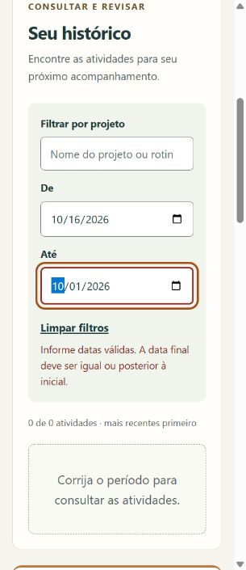

# Revisão de entrega — 16/10/2026

## Resultado desta revisão

- 48 testes automatizados passaram com Node.js 24.14.0.
- Identificação acessível do campo inicial quando sua data é inválida; indicação removida após correção.
- Foco devolvido ao seletor de arquivo quando uma prévia de importação fica desatualizada.
- Botão Confirmar importação associado à descrição da prévia por aria-describedby.
- Filtros empilhados até 420 pixels: o campo nativo de data antes ficava cortado em 320 pixels.
- Cache incrementado para v11. Atualização v10 → v11 aguardou fechamento da aba e preservou a lixeira.

## Verificação no navegador integrado

Foi usada a porta 4177, separada do histórico da porta padrão. Os dados foram fictícios.
Tab percorreu os controles do conteúdo até a importação, incluindo os segmentos nativos
dos campos de data. Enter abriu a importação e acionou cadastro e remoção; o foco
após cadastro e remoção foi conferido. Não foi observado bloqueio de teclado nesse
percurso. Isso não é uma auditoria de todas as combinações de interação.

Projeto e descrição com sequências extensas sem espaços quebraram dentro do cartão
em 320 pixels, sem transbordamento horizontal. Depois da correção, as datas dos
filtros ficaram legíveis e a mensagem de período invertido permaneceu visível.

## Contraste medido a partir das cores do CSS

Cálculo de luminância relativa sRGB e razão (L maior + 0,05) / (L menor + 0,05).
São combinações selecionadas, sem auditoria automatizada integral da página.

| Combinação | Razão |
| --- | --- |
| Texto principal / superfície | 11,90:1 |
| Texto secundário / fundo da página | 5,82:1 |
| Placeholder / campo branco | 5,03:1 |
| Borda de campo / fundo dos filtros | 3,20:1 |
| Indicador de foco / superfície | 5,64:1 |
| Texto branco / botão principal | 11,99:1 |

## Validações que ainda precisam ser realizadas

Não há leitor de tela ou controle de instalação nativa disponível nesta sessão.
O controle de viewport não comprova zoom do navegador. Estes itens não estão aprovados:

1. Em navegador real, testar zoom a 200% e 400%, foco visível, leitura e ações sem perda de conteúdo.
2. Com NVDA ou VoiceOver, conferir nomes dos campos, mensagens de erro, leitura da prévia,
   remoção/restauração e avisos da PWA. Registrar sistema e versão do leitor.
3. Instalar em aparelho real, fechar e abrir pelo ícone, ativar modo avião e repetir
   cadastro, consulta, lixeira, exportação e importação.
4. Publicar o conjunto em HTTPS e verificar atualização com duas abas abertas.
5. Pedir a duas ou três pessoas do público para registrar uma entrega e recuperar
   atividades de uma semana/projeto. Registrar dificuldades e ajustes sugeridos.

Esses testes devem registrar ambiente, passos e resultado observado. Um manifesto
válido, uma árvore de acessibilidade legível ou uma simulação de tela pequena não
substituem essas verificações.

## Material de entrega

O README reúne problema, público, funcionamento, tecnologias, execução, decisões,
dificuldades, imagens e limites. O guia GUIA-DO-CODIGO.md detalha o código para estudo
e preparação de entrevista, com atenção ao armazenamento e a um exemplo de teste.
As capturas da etapa 3 preservam o registro daquela etapa; a captura acima mostra a
correção posterior dos filtros. Não houve publicação nem envio de alterações ao GitHub.

A versão v11 também foi recarregada com o servidor desligado: a página abriu pelo cache e o registro da lixeira permaneceu disponível. O servidor de teste foi encerrado.

## Conferência de encerramento

A refatoração da versão atual foi encerrada após uma nova execução dos 48 testes,
todos aprovados. A inspeção complementar confirmou sintaxe válida nos 11 arquivos
JavaScript, 17 referências locais existentes na documentação, dimensões corretas dos
dois ícones do manifesto e presença dos 10 recursos offline. Não foram necessários
novos ajustes no código nesta conferência. A versão do cache permanece v11.

As validações externas listadas neste documento continuam pendentes. Este encerramento
não equivale a aprovação em dispositivos não testados, auditoria completa de
acessibilidade ou publicação em produção.

## Correção posterior — 12/11/2026

Relato: buscar palavras do título não encontrava a atividade. Causa confirmada: consulta restrita ao projeto. Corrigido para pesquisar título, projeto e descrição, com novo rótulo e cache v12. Os dois novos testes falharam antes da correção. Após a correção, os 50 testes automatizados passaram.
